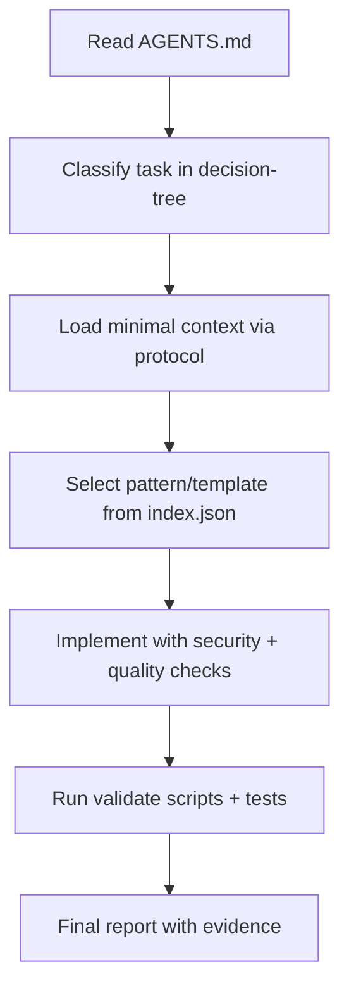

# power-apps-code-apps-agent-skill

Universal, evidence-driven skill library for AI agents that build production-grade Power Apps Code Apps.

## Value proposition
- Prevents schema hallucination (especially SharePoint internal names).
- Guides secure, testable, accessible implementation.
- Supports SharePoint-first projects with Dataverse support.
- Works with GitHub Copilot, Claude Code, Codex, Cursor, and compatible agents.

## Quick start
1. Open `AGENTS.md` first.
2. Follow `library/context-loading-protocol.md` to load only relevant docs.
3. Use `library/decision-tree.md` to classify the task.
4. Resolve task-specific docs through `library/index.json`.
5. Run validations:
   ```bash
   npm run validate
   npm test
   ```

## Início rápido (PT-BR)
1. Leia `AGENTS.md`.
2. Use `library/context-loading-protocol.md` para carregar contexto incremental.
3. Use `library/decision-tree.md` para classificar a tarefa.
4. Consulte `library/index.json` para localizar playbooks e templates.
5. Execute:
   ```bash
   npm run validate
   npm test
   ```

## Library structure
```text
AGENTS.md
library/
skills/
templates/
examples/
scripts/
tests/
adapters/
```

## Agent compatibility
- GitHub Copilot: `adapters/github-copilot.md`
- Claude Code: `adapters/claude-code.md`
- Codex: `adapters/codex.md`
- Cursor: `adapters/cursor.md`
- Generic adapter: `adapters/generic.md`

## Use cases
- Create SharePoint CRUD pages with strict schema discipline.
- Build Dataverse flows with environment-aware security.
- Add dashboard, master-detail, and approval workflows.
- Run security/quality validations before final output.

## Decision and execution flow


## Installation / copy / consult
- **Clone as a reference repository** and point your agent to `AGENTS.md`.
- **Copy selected folders** (`library`, `skills`, `templates`) into internal standards repos.
- **Programmatic access**: parse `library/index.json` and filter by tags/category.

## Example prompts
- "Use AGENTS.md and the context-loading protocol. Build a SharePoint CRUD page for observed schema only."
- "Classify this task using decision-tree and return minimal docs list before coding."
- "Perform security and quality DoD checks and produce final report in universal format."

## Recommended stacks and trade-offs
See `ARCHITECTURE.md` for the matrix:
- Recommended: React + TypeScript + Vite + service/data layer + schema validation + tests.
- Acceptable: alternatives with equivalent guarantees.
- Avoid: direct HTTP bypassing generated services, untyped payloads, and schema guessing.

## Roadmap
- **v0.1**: core operational docs, index, validation scripts, base examples.
- **v0.2**: richer examples, stricter rubric automation, more adapters.
- **Future**: benchmark packs, telemetry quality gates, multi-tenant policy packs.

## Contributing
See `CONTRIBUTING.md` and `GOVERNANCE.md`.

## Public project quality notes
- Badges intentionally omitted unless real CI/release endpoints are configured.
- Official Power Platform details can change; verify against current official documentation.

## Official references
- Power Apps Code Apps overview: https://learn.microsoft.com/en-us/power-apps/developer/code-apps/overview
- SharePoint operations for Code Apps: https://learn.microsoft.com/en-us/power-apps/developer/code-apps/how-to/sharepoint-operations
- Microsoft PowerAppsCodeApps repository: https://github.com/microsoft/PowerAppsCodeApps

Some platform details can change over time; verify against current official documentation.
