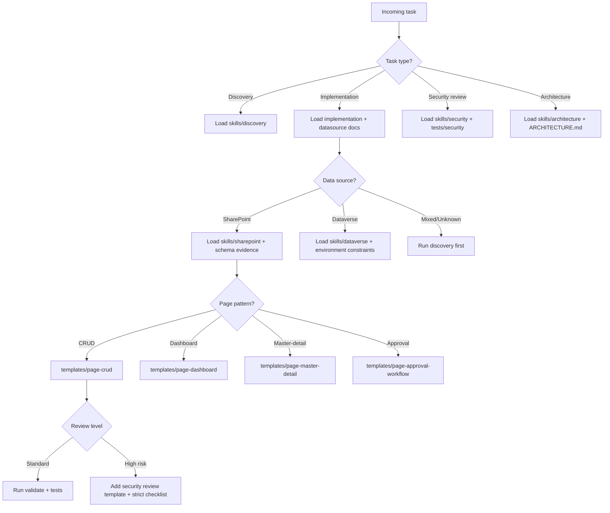

# Decision Tree

## Review levels
- **Standard**: regular feature scope with known schema.
- **Elevated**: permission-sensitive, PII-related, or cross-environment data.
- **High risk**: auth/security boundary changes, uncertain schema, external integrations.
